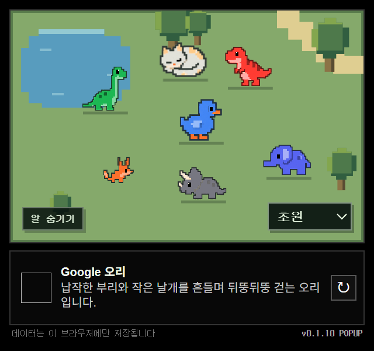

# Tab Zoo 🦕

> Your open tabs become pixel animals that grow, sleep, and vanish.

열어 둔 브라우저 탭이 작은 도트 동물이 되어 자라는 Chrome 확장 프로그램입니다.

사이트마다 동물이 한 마리씩 태어나고, 그 사이트에 머문 시간만큼 자랍니다. 방치하면 졸다가 잠들고, **그 사이트의 탭을 모두 닫으면 동물도 떠납니다.** 사용 기록을 쌓아 두는 통계 앱이 아니라, 지금 열려 있는 탭을 작은 동물원처럼 돌보는 확장입니다.

<p align="center">
  
</p>

## 어떻게 동작하나요

- **사이트(도메인)마다 한 마리**: 탭 단위가 아니라 도메인 단위입니다. YouTube 탭을 3개 열어도 동물은 1마리입니다. 처음 보는 사이트를 열면 7종(목긴공룡, 티라노, 트리케라톱스, 고양이, 사막여우, 오리, 코끼리) 중 무작위로 알이 생기고, 몸 색은 그 사이트 파비콘의 대표색입니다.
- **머문 시간만큼 성장**: 그 사이트 탭을 앞에 띄워 둔 누적 시간 기준입니다.

  | 누적 시간 | 1분 미만 | 1–5분 | 5–60분 | 60–120분 | 120분 이상 |
  | --- | --- | --- | --- | --- | --- |
  | 단계 | 알 | 유년체 | 성체 | 거대종 | 최대 크기 |

- **머무는 방식이 체형이 됨**: 한 번에 오래 머물면 몸통이 통통해지고, 탭 사이를 자주 오가면 날렵해집니다.
- **방치하면 잠듦**: 마지막으로 본 뒤 10분이 지나면 졸기 시작하고, 35분이 지나면 잠듭니다.
- **진짜 본 시간만 셈**: 5분간 입력이 없거나, 화면이 잠기거나, 브라우저 창이 포커스를 잃으면 시간을 멈춥니다. 소리가 나는 탭(영상·음악)은 입력이 없어도 계속 셉니다.
- **탭을 닫으면 작별**: 그 사이트의 탭을 모두 닫거나 브라우저를 완전히 종료하면 동물과 기록이 사라지고, 다시 열면 새 알부터 시작합니다.
- 동물을 클릭하면 그 탭으로 이동합니다. 맵은 초원·시베리아·사막 중에서 고를 수 있습니다.

정확한 기준값은 [background.js](extension/background.js) 상단 상수와 [popup.js](extension/popup.js)의 `visualFromMetrics()`에 있습니다.

## 설치해서 써보기

아직 Chrome 웹스토어에는 없고, 빌드 없이 바로 불러올 수 있습니다. Chrome 121 이상(또는 Edge)이 필요합니다.

1. 이 저장소를 받습니다 (`git clone` 또는 **Code → Download ZIP** 후 압축 해제).
2. `chrome://extensions` (Edge는 `edge://extensions`)를 엽니다.
3. 우측 상단 **개발자 모드**를 켭니다.
4. **압축해제된 확장 프로그램을 로드**를 누르고 `extension/` 폴더를 선택합니다.
5. 툴바의 퍼즐 아이콘에서 Tab Zoo를 고정하고 누르면 팝업이 열립니다.

## 권한과 개인정보

모든 기록은 내 브라우저의 `chrome.storage.local`에만 저장되고, 어떤 서버로도 전송되지 않습니다. 파비콘도 Chrome이 이미 가진 캐시에서 읽습니다.

| 권한 | 쓰는 이유 |
| --- | --- |
| `tabs` | 지금 보고 있는 탭의 주소·제목을 알아내 도메인별 동물을 만들고, 클릭 시 그 탭으로 이동 |
| `storage` | 체류 시간·동물 종·설정을 브라우저 안에 저장 |
| `favicon` | 사이트 아이콘에서 동물 색을 뽑기 |
| `idle` | 자리를 비운 시간을 체류 시간에서 빼기 |
| `alarms` | 1분마다 진행 중인 체류를 저장 |

자세한 내용은 [개인정보처리방침](extension/PRIVACY.md)을 참고하세요.

## 폴더 구조

```
extension/        Chrome 확장 프로그램 본체 (이 폴더를 로드)
  background.js     체류 시간·방문 기록, 유휴 감지, 초기화 (서비스 워커)
  popup.*           팝업 UI와 맵
  sprite-art.js     동물 그림 프레이밍·색 입히기
  atlas-clips.js    아틀라스 PNG에서 동물을 잘라내는 데이터 (자동 생성)
  movement.js       맵 위 걷기
  assets/           동물 아틀라스와 아이콘
  *-preview.html    디자인 확인용 미리보기 (배포 패키지에서는 빠짐)
tests/            테스트와 개발용 스크립트
scripts/          웹스토어 업로드용 zip 생성
design-archive/   이전 디자인 버전 (각각 단독으로 로드 가능)
docs/             README 이미지
```

초기에 성장 규칙을 실험하던 웹 프로토타입(Behavior Lab)은 [`archive/behavior-lab`](../../tree/archive/behavior-lab) 브랜치에 보관되어 있습니다.

## 개발

```bash
npm test                    # 확장 프로그램 테스트 (Node.js 22+, npm install 불필요)
npm run package:extension   # 웹스토어용 zip을 outputs/에 생성 (Windows PowerShell 전용)
```

함께 개발하는 방법, 코드 구조, 새 동물·맵 추가법은 [CONTRIBUTING.md](CONTRIBUTING.md)에 있습니다.

## 그림 출처

동물 그림은 AI 이미지 생성 도구로 만든 뒤 잘라내기와 색 입히기를 더했습니다. 생성 과정과 프롬프트는 [ARTWORK.md](extension/assets/ARTWORK.md)에 기록되어 있습니다.

## 라이선스

[MIT](LICENSE)
